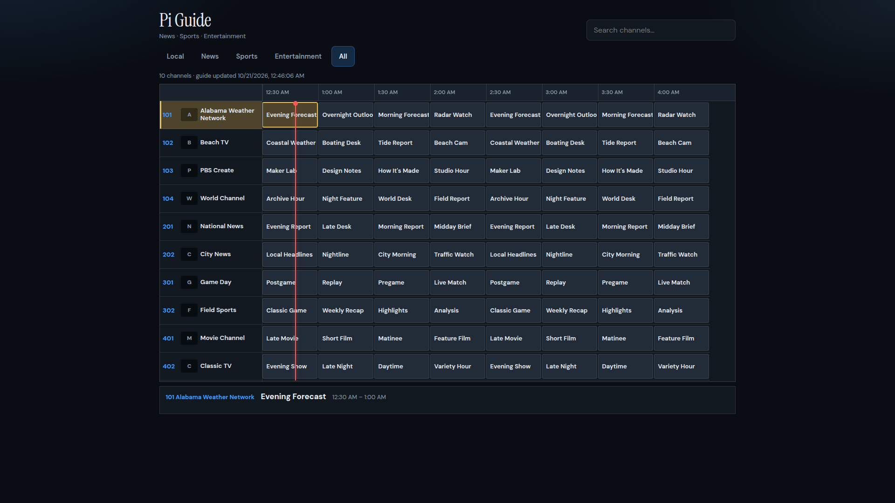

# Pi IPTV Channel Guide

[](LICENSE)
[](https://www.python.org/)

Cable-box style EPG for **US News, Sports & Entertainment**, plus a **local market** you configure yourself.
Browse channels and what’s on, then click to play on the Pi HDMI output.

On your LAN, open `http://<pi-address>:8080`. There is no login. Do not forward port 8080 to the internet. Playback only starts stream URLs that are already in the loaded catalog.



The picture is the guide with the All tab selected. Programme titles in that shot are filled in so the grid is visible; a running Pi loads schedules from the XMLTV feed below.

## Features

- Cable-box guide: channel numbers, time ruler, program grid, “now” line
- Tabs: Local · News · Sports · Entertainment · All
- Search, arrow-key navigation, Enter to play
- Now-playing bar with Stop
- Playlist + EPG auto-refresh every 6 hours
- Channels without programme listings are hidden automatically (`hide_unguided`)

## EPG

Schedules come from the US XMLTV feed at [iptv-epg.org](https://iptv-epg.org/) (`epg-us.xml.gz`), matched to channels by `tvg-id`. Only programmes for channels in your playlist are cached (`data/epg.json`).

Configure in `app/config.yaml`:

```yaml
epg_url: "https://iptv-epg.org/files/epg-us.xml.gz"
epg_refresh_hours: 6
hide_unguided: true   # false = keep streams with no listings (Live placeholder)
```

Refresh playlist and EPG:

```bash
curl -X POST http://127.0.0.1:8080/api/refresh
```

## Playback

The guide detects the Pi display mode on each play:

1. **Desktop** (X11 `/tmp/.X11-unix/X0` or Wayland socket) → **VLC** fullscreen with ALSA audio  
2. **No desktop** (console / fb only) → **mpv DRM** (preferred) or **ffmpeg → `/dev/fb0` + aplay**

Install VLC when you use a desktop session: `sudo apt install -y vlc` or `./deploy/install-vlc.sh`.

`GET /api/status` reports `output_kind` (`desktop` | `framebuffer` | `none`) and the last `backend`.

### Smoothing (Starlink / high jitter)

Raw download speed is rarely the limit — latency spikes are. Defaults target that:

```yaml
network_cache_ms: 12000      # VLC demuxer buffer; also sizes ffmpeg IO timeouts
hls_live_start_index: -8     # start ~8 HLS segments behind live edge
stream_buffer: true          # copy HLS into /dev/shm before decode
stream_buffer_segments: 5    # wait for N local segments before play
max_display_fps: 30          # drop 60fps live feeds to 30 for Pi CPU
```

Channel clicks take ~10–15s longer while the RAM buffer fills; playback should stay smoother on Starlink.

On the Pi, `gpu_mem=256` is set in `/boot/firmware/config.txt` (needs reboot).

## Local channels

OTA affiliates are often missing from iptv-org. Match them by putting market names and call signs in `app/config.local.yaml` (gitignored — see `app/config.local.yaml.example`), and optional HLS URLs in `data/local.m3u`:

```bash
cp app/config.local.yaml.example app/config.local.yaml
cp data/local.m3u.example data/local.m3u
```

`data/local.m3u.example` includes two national PBS streams as a format sample. Then refresh as above.

## Deploy

A push to `main` deploys on the Pi. The GitHub Actions runner there checks out that commit, syncs it into `/home/pi/iptv-guide`, and restarts the guide. Local market files (`app/config.local.yaml`, `data/local.m3u`) and the cached playlist and EPG stay on the Pi.

To deploy from this machine instead:

```bash
IPTV_HOST=pi@10.20.20.119 ./deploy/deploy.sh
```

`IPTV_HOST` is required. `IPTV_REMOTE_DIR` defaults to `/home/pi/iptv-guide` (the usual Raspberry Pi OS account, not a personal path). The same script copies gitignored `app/config.local.yaml` and `data/local.m3u` when they exist in this tree, so a deploy from your machine still carries the local market.

`deploy/install-console-helper.sh` grants the `pi` user passwordless sudo for `/usr/local/sbin/iptv-console` and restarting this service. Install that only on a Pi you trust.

Runs as a **user systemd** service (`systemctl --user status iptv-guide`).
To keep it after logout (needs sudo once): `sudo loginctl enable-linger pi`

## Develop locally

```bash
python3 -m venv .venv
source .venv/bin/activate
pip install -r requirements.txt
cd app && uvicorn main:app --host 0.0.0.0 --port 8080
```

Open http://localhost:8080 — first start may take a minute while the playlist and EPG download.

## License

[MIT](LICENSE)
